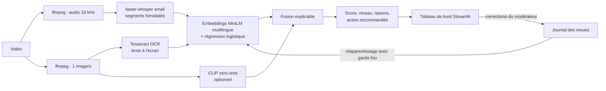

# Garde-Fil

Prototype d'aide à la modération de vidéos courtes (format TikTok). Garde-Fil analyse ce qui est dit, ce qui est écrit à l'écran et, en option, ce qui est montré à l'image, puis produit un score de risque expliqué et horodaté. Il ne supprime rien : il signale, explique pourquoi, et un modérateur humain décide. L'action recommandée oriente vers une ressource d'aide plutôt que vers un simple blocage.

Le projet vise à terme les contenus liés à l'automutilation et au suicide. Pour des raisons éthiques et légales, il est développé et évalué sur un sujet voisin, le harcèlement en ligne, avec des données publiques et des vidéos de test synthétiques. La méthode de transposition au vrai sujet est décrite dans [docs/ethique-rgpd.md](docs/ethique-rgpd.md).

> Si toi ou un proche traversez une période difficile, le 3114 (numéro national de prévention du suicide) est gratuit et joignable 24 h/24, 7 j/7.

## Principes

1. L'humain décide. Le système trie et explique ; il n'agit jamais seul sur un contenu.
2. Orienter plutôt que bloquer. L'action recommandée renvoie vers une ressource d'aide (3018 sur le sujet voisin, 3114 sur le vrai sujet).
3. Juger le sens, pas les mots. La classification repose sur des embeddings sémantiques, sans liste de mots-clés.
4. Ne pas signaler la prévention. Un message de prévention ou un témoignage de guérison parle du sujet sans être à risque ; c'est le cas de test prioritaire.
5. Expliquer chaque signalement : quoi, où (parole, écran, image), quand, avec quel score.

## Architecture



La fusion regroupe les passages signalés proches dans le temps en « moments ». Le score d'un moment est celui de son pire passage, augmenté si plusieurs sources convergent (dit et écrit au même instant, par exemple). Le score global est celui du pire moment, augmenté si plusieurs moments distincts sont signalés. Les bonus comblent une part de la marge restante jusqu'à 1 au lieu d'ajouter une valeur fixe, ce qui évite de saturer à 1,00.

Trois niveaux en sortent : faible (non transmis au modérateur), modéré (revue standard) et élevé (revue prioritaire). Deux règles de sûreté s'ajoutent :

- un texte de moins de 3 mots ne peut pas déclencher une alerte à lui seul, car le classifieur n'est pas fiable sans contexte ;
- l'image seule, issue d'un modèle non calibré, ne peut pas dépasser le niveau modéré.

## Stack

Python 3.11, ffmpeg, faster-whisper (modèle `small`, int8 sur CPU), Tesseract (`fra`), sentence-transformers (`paraphrase-multilingual-MiniLM-L12-v2` pour le texte, `clip-ViT-B-32` pour l'image), scikit-learn, Streamlit. Tout tourne en local sur un Mac avec 8 Go de RAM : aucune vidéo ni transcription ne part vers un service externe.

## Installation (macOS)

```bash
brew install python@3.11 ffmpeg-full tesseract tesseract-lang git
# ffmpeg-full (nécessaire pour le filtre drawtext) n'est pas ajouté au PATH par défaut
echo "export PATH=\"$(brew --prefix ffmpeg-full)/bin:\$PATH\"" >> ~/.zshrc && source ~/.zshrc

git clone <url-du-dépôt> Garde-Fil && cd Garde-Fil
python3.11 -m venv .venv && source .venv/bin/activate
pip install --upgrade pip && pip install -r requirements.txt
python scripts/check_env.py   # tout doit être vert
```

Au premier lancement, les modèles sont téléchargés depuis Hugging Face (environ 1,6 Go au total).

## Utilisation

```bash
# 1. Entraîner le classifieur de texte sur le jeu public (sujet voisin)
python scripts/train_text_classifier.py

# 2. Générer une vidéo de test synthétique (voix macOS + texte incrusté)
./scripts/make_test_video.sh "texte parlé" "texte à l'écran" data/videos/exemple.mp4

# 3. Analyser une ou plusieurs vidéos en ligne de commande
python -m src.pipeline data/videos/exemple.mp4            # --no-vision pour désactiver CLIP

# 4. Tableau de bord du modérateur (http://localhost:8501)
streamlit run app/dashboard.py

# 5. Réentraîner avec les revues du modérateur (garde-fou de non-régression)
python scripts/retrain_with_feedback.py

# 6. Évaluation de bout en bout sur le jeu de test vidéo
python scripts/build_eval_videos.py && python scripts/evaluate.py
```

## Résultats

Classifieur de texte, sur 955 textes de test du jeu public (`textdetox/multilingual_toxicity_dataset`, partie française) : F1 0,894 (précision 0,888, rappel 0,901 sur la classe à risque). Après intégration de 6 exemples corrigés par le modérateur, le F1 est de 0,893.

Évaluation de bout en bout sur 23 vidéos synthétiques ([détail](docs/evaluation.md)), seuil d'alerte 0,50 :

| Précision | Rappel | F1 | Prévention signalée à tort |
|---|---|---|---|
| 0,78 | 0,78 | 0,78 | 0/5 |

| Catégorie | Attendu | Corrects |
|---|---|---|
| Neutre | ignoré | 5/5 |
| Négatif sans cible (« ce film était nul ») | ignoré | 1/2 |
| Harcèlement explicite (parole, écran ou les deux) | signalé | 5/5 |
| Exclusion formulée calmement | signalé | 1/3 |
| Prévention, information, témoignage de guérison | ignoré | 5/5 |
| Image : repas / dispute / match de boxe | ignoré / signalé / ignoré | 1/1, 1/1, 0/1 |

Ces chiffres viennent d'un jeu petit et synthétique, calibré et mesuré sur les mêmes cas. Ils sont indicatifs, pas une mesure de performance en conditions réelles.

## Ce que le développement a montré

Les erreurs de transcription ne cassent pas la détection. Whisper a transcrit « T'es » en « C'était » et la vidéo est restée signalée (0,82), parce que l'embedding capte le sens global de la phrase. Dans l'autre sens, un titre « Test toxique » obtient 0,07 : le modèle ne réagit pas au mot, mais au sens.

L'OCR rattrape ce que la parole rate. Sur une vidéo où la voix est neutre et le message n'est qu'écrit, la parole obtient 0,06 et le texte à l'écran 0,86.

Le jeu de données compte plus que le modèle. Les formulations agressives sont bien détectées ; l'exclusion formulée calmement (« on a créé un nouveau groupe sans toi ») beaucoup moins. Aucun seuil ne rattrape un score de 0,18 : il faut des données qui couvrent ce type de formulation. C'est l'argument principal pour utiliser, sur le vrai sujet, des données annotées par des cliniciens.

Corriger une cause plutôt que monter un seuil. La première évaluation signalait à tort un contenu de prévention, à cause de son titre de deux mots (« Chiffres clés », 0,61). Le seuil « optimal » calculé (0,65) supprimait cette erreur mais faisait perdre un vrai cas de harcèlement ; il a été refusé, car rater un contenu à risque est plus grave qu'une fausse alerte. La règle des 3 mots minimum a supprimé l'erreur sans perte de rappel. Après correction, monter le seuil ne fait plus que perdre du rappel.

Les corrections du modérateur se généralisent un peu. Sur des formulations d'exclusion jamais vues, le score augmente de 0,03 à 0,10, et un cas franchit le seuil uniquement grâce à une correction (0,43 à 0,53), sans effet sur les contenus de prévention (±0,04). Une correction isolée ne suffit pas à renverser le modèle, ce qui limite l'effet d'une erreur ou d'une malveillance.

L'image détecte le contenu, pas l'intention. CLIP signale une dispute (0,91) mais aussi un match de boxe (0,96). D'où le plafond au niveau modéré quand seule l'image signale un risque.

Le profilage a déplacé l'effort d'optimisation. 66 % du temps de la première analyse venait du chargement à froid des modèles, pas du calcul. Après préchargement, la première vidéo passe de 7,9 s à 3,05 s, avec des résultats identiques. Le benchmark Whisper a conduit à garder `small` (RTF 0,27) plutôt que `base` (RTF 0,11), qui transcrivait « ferme-la et dégage » en « ferme l'aédégage » et perdait le mot le plus agressif.

## Limites

L'exclusion calme reste mal détectée (2 cas sur 3 manqués). Le modèle confond parfois négativité et toxicité (« cette journée est horrible », 0,50). L'image ne comprend pas le contexte. Le jeu de test est synthétique (voix de synthèse, fonds unis), sans vraies vidéos, ni musique, ni montage rapide. Le tableau de bord n'a pas d'authentification et n'est prévu que pour un usage local. Le classifieur est entraîné sur un sujet voisin : rien ne garantit ses performances sur le vrai sujet sans données adaptées.

## Éthique, RGPD et transposition

Aucun contenu d'automutilation n'a été collecté pour ce projet. Les données personnelles (transcriptions, images extraites, revues) restent dans `data/`, exclu de Git. Le modérateur est identifié par un pseudonyme. Le cadre complet (RGPD, DSA, biais, sécurité, accès aux jeux de recherche sous convention, rôle des cliniciens) est dans [docs/ethique-rgpd.md](docs/ethique-rgpd.md).

## Structure du dépôt

```
app/dashboard.py          tableau de bord du modérateur
src/                      pipeline : extract, transcribe, ocr, vision, text_classifier, fusion, feedback, config
scripts/                  entraînement, réapprentissage, évaluation, génération de vidéos, benchmark
eval/cases.yaml           jeu de test vidéo synthétique (23 cas, versionné)
docs/                     évaluation, éthique et RGPD, démo
data/, models/            données et modèles locaux (jamais versionnés)
```

## Droits d'utilisation

Tous droits réservés. Le code est publié pour être consulté ; aucune licence n'accorde le droit de le réutiliser, de le modifier ou de le redistribuer.

Données et modèles tiers, soumis à leurs propres licences : `textdetox/multilingual_toxicity_dataset` (licence OpenRAIL++), `paraphrase-multilingual-MiniLM-L12-v2` (Apache 2.0), Whisper et CLIP d'OpenAI (MIT).
